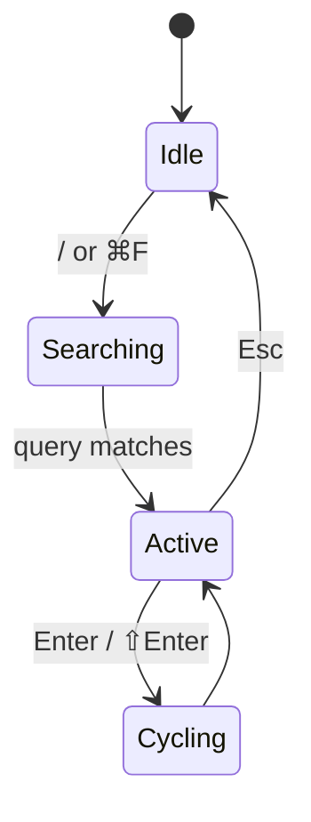

# A Field Guide to mdview

> A short tour of what this viewer does, written in the viewer itself. Best read with the outline pane open and focus mode toggled on — press `f`.

mdview is a local CLI markdown viewer. It does one thing — render `.md` files in your browser, on your machine, with editorial typography and live reload — and it tries to do that thing very well. This document is a tour of every feature surface in one scroll, so you can see what the tool is for without leaving the tool.

## Why local

There are plenty of ways to read markdown in 2026. You can paste into a web playground, push to a private gist, run a static site generator, or just `cat` the file in your terminal. Each works. Each also asks something in return — an internet connection, a build step, a publish step, a tab you forget to close.

mdview is built for the case where you have a long `.md` open in your editor and you want to *see* it the way a reader would, right now, with no ceremony. You run a command, a browser tab opens, and edits propagate over SSE. One small background server on 127.0.0.1 hosts every folder you open, and `mdview stop` ends it. There is no cache to clear and no account to log into.

> Local-first isn't a philosophy here. It's a constraint that saved the project from building things I'd have regretted.

## The reading surface

The body is set in a humanist serif at a generous 1.72 line-height. The accent color, the dashed border under the metadata strip, the small caps in the doc-stats row — none of these are accidents. They borrow from print design, where centuries of practice have settled on what makes a page restful to read.

Things you can do on this page right now:

- **Toggle focus mode** with `f`. The section under your eyes brightens; the rest dims to 25%. The "section under your eyes" is anchored to the top third of the viewport, not the top edge — that matters more than it sounds.
- **Switch palettes** from the View menu (the gear icon, top-right). Flexoki, paper, solarized, everforest, rose-pine, kanagawa, catppuccin, high-contrast. Code blocks follow the palette.
- **Toggle the minimap** with `m`. A thin rail of heading bars appears at the right edge, with a viewport indicator that follows your scroll.
- **Collapse a section.** Hover any heading; a small chevron appears to the left of the title. Click it to fold every paragraph and subsection until the next heading at the same level. `e` expands everything, `⇧E` collapses everything.

### Blockquote, since you asked

> "There is no perfect reading environment. There is only the one you've stopped fighting with."
> — *Anonymous, somewhere on the internet*

### Two kinds of lists

Ordered, for procedure:

1. Install the binary.
2. Point it at a folder.
3. Stop thinking about it.

Unordered, for everything else:

- Frontmatter is parsed and shown as a collapsed `<details>` at the top.
- External links get a small `↗` icon and `rel="noopener noreferrer"`.
- Images render via a safe `/__asset/*` route and open in a lightbox when clicked.
- Internal `[link](other.md)` jumps stay inside the SPA — no full page load.

### Task list

- [x] Render markdown beautifully
- [x] Live-reload on file save
- [x] Add collapsible sections
- [ ] World domination

## Code at home

mdview highlights code with Shiki on the server, for the active palette only: each token carries a light and a dark colour variable, and CSS picks one from `[data-theme]`. The light/dark toggle is therefore instant; a palette switch refetches the document. Unchanged blocks come from a cache on live reload.

```typescript
// A tiny example, intentionally not useful.
import { signal } from "@preact/signals";

const counter = signal(0);

function increment(): number {
  counter.value += 1;
  return counter.value;
}

export { counter, increment };
```

Same Shiki engine, different language:

```python
def fib(n: int) -> int:
    """Naive Fibonacci, because elegance > performance for n < 30."""
    if n < 2:
        return n
    return fib(n - 1) + fib(n - 2)


print([fib(i) for i in range(10)])
```

A bit of shell, for variety:

```bash
mdview ./docs                # browse a folder
mdview README.md             # view a single file
mdview --port 9000 ./notes   # custom port
```

Hover any code block and a **Copy** button fades in at the top right. Click it; the button briefly flashes "Copied".

## Math, drawn

Inline math is exactly as easy as you'd hope: $E = mc^2$ for the classics, $\sigma = \sqrt{\frac{1}{N}\sum_{i=1}^N (x_i - \mu)^2}$ for the messy ones. KaTeX loads lazily — the chunk only fetches when a doc actually contains math.

Block math goes on its own line:

$$
\int_{-\infty}^{\infty} e^{-x^2}\, dx = \sqrt{\pi}
$$

$$
\begin{pmatrix} a & b \\ c & d \end{pmatrix}
\begin{pmatrix} x \\ y \end{pmatrix}
=
\begin{pmatrix} ax + by \\ cx + dy \end{pmatrix}
$$

## Diagrams

Mermaid diagrams render with pele, imported the first time a `mermaid` fence shows up in any doc you've opened this session. A page loads only the diagram types it uses, and diagrams follow the active palette.

```mermaid
flowchart LR
    A[CLI argv] --> B[Fastify server]
    B --> C[markdown-it pipeline]
    C --> D[/api/file → JSON]
    D --> E[Preact SPA]
    E -->|SSE watch| B
```

State diagrams work too:



## Anatomy

The three panes, in plain words:

| Pane | Default width | What lives there |
|------|---------------|------------------|
| Left | 220 px | Folder tree. Cmd-click any file to open it in a new tab. |
| Center | 70 ch (100 ch in wide mode) | The rendered document. Scroll position is preserved across live reloads. |
| Right | 260 px | Outline derived from headings. Click any entry for a scroll-spy-locked jump. Six toggle pills filter heading levels. |

And the small star icon, just because:


## A long thought, in pieces

This section exists to demonstrate scroll behavior. As you scroll, the breadcrumbs in the header update to the topmost heading you've passed. The outline highlight pins on the same heading. The reading-progress bar at the bottom edge of the header fills proportionally.

### On margins

The instinct of inexperienced typesetters is to fill the page edge-to-edge, on the theory that whitespace is wasted space. The opposite is true: margins are what let the eye land somewhere when it lifts off the line. Without them you read the text, but you don't *settle* into it. The default reading column here is capped at 70 ch — about 65 characters of visible text per line — which keeps the eye's return journey short.

### On line height

The 1.72 multiplier this page uses is higher than the web's default of 1.2–1.5. The cost is vertical space; the benefit is that long paragraphs become approachable instead of intimidating. Combined with the serif body, the result is closer to a printed page than to a typical web app. If you want to test the difference, toggle wide layout (`w`) — the column relaxes to 100 ch and the same paragraphs feel measurably denser.

### On color

The accent is a warm ochre in the default palette, Flexoki. It appears at every level of hierarchy: under H1s, on list markers, on the active outline pill, on link underlines, on focus-mode highlights, on the copy-button hover state, on the reading-progress bar. One color, used consistently, gives a page a personality. The other seven palettes each pick a different accent, and code blocks follow the choice automatically.

### On hierarchy

Six heading levels, each tuned: H1 is italic and accented and underlined with a small bar; H2 has a quiet bottom border; H3 is bold sans; H4 is all-caps tracked small caps; H5 and H6 settle into muted weights. Open the outline pane and the visual treatment maps directly onto the structure of the document.

## Keyboard navigation

| Key | Action |
|-----|--------|
| `j` / `k` | Next / previous heading |
| `gg` / `⇧G` | Top / bottom of document |
| `[` / `]` | Previous / next heading at the same level |
| `⇧H` / `⇧L` | Previous / next file in folder |
| `f` | Toggle focus mode |
| `m` | Toggle minimap |
| `w` | Toggle wide layout |
| `e` / `⇧E` | Expand / collapse every section |
| `⌘P` | Quick file switcher |
| `⌘F` or `/` | Open in-doc search |
| `⇧⌘F` | Folder-wide search |
| `?` | Show shortcuts panel |

The full registry lives in `src/client/shortcuts.ts` — adding one is a single entry in one file.

## References

This doc links to itself a few times for testing. Click [Anatomy](#anatomy) to scroll back to the table. Click [Keyboard navigation](#keyboard-navigation) to scroll forward.

External links work too — [the GitHub repo](https://github.com/hardikg2907/mdview) opens in a new tab with the small `↗` icon.

---

*That's the tour.* Run `mdview` against your own folder of notes, drafts, RFCs, or runbooks, and the tool starts paying for itself by the second long doc.
